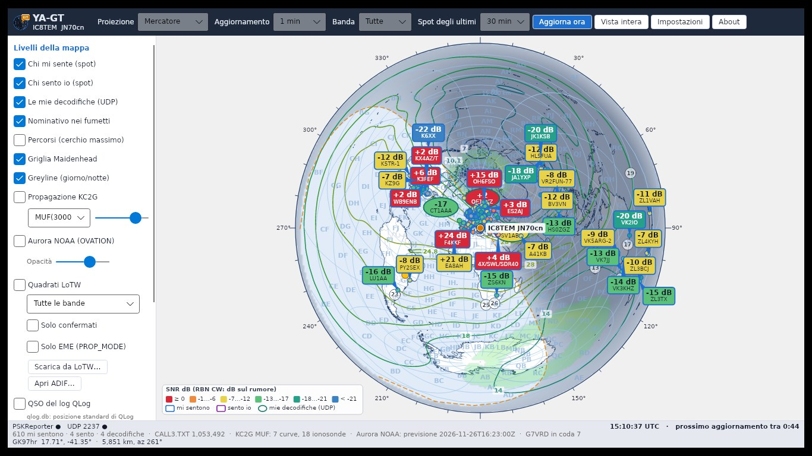

# YA-GT

**Italiano** · [English](#english)

YA-GT mostra su una mappa del mondo chi riceve il tuo nominativo e chi ricevi tu, con un **fumetto ben visibile con il valore SNR** per ogni stazione, insieme ai tuoi QSO di LoTW, di QLog e degli altri log di stazione, alle tue decodifiche UDP, alla greyline, alla propagazione KC2G e all'aurora del NOAA. **Ogni funzione è un livello della mappa** e si accende o si spegne a scelta.

Interfaccia in **37 lingue** (le stesse di tutti i programmi IC8TEM): al primo avvio quella del sistema, poi si sceglie in *Impostazioni > Lingua*.

A cura di **Costantino Cerrotta • IC8TEM** — ccerrotta@gmail.com · ic8tem@gmail.com · [qrz.com/db/ic8tem](https://www.qrz.com/db/ic8tem) · [ko-fi.com/ic8tem](https://ko-fi.com/ic8tem)

## Avvio

Alla prima apertura si inseriscono **nominativo** e **locatore a 6 caratteri** (es. `JN70cn`). Il locatore fa da centro della mappa azimutale e serve a calcolare distanza e azimut di ogni spot.

## La mappa

- **Mercatore** oppure **azimutale equidistante** centrata sul tuo locatore (menu *Proiezione*).
- Rotella = zoom sul punto, trascinamento = spostamento, doppio clic = vista intera. Passando sopra un fumetto si leggono i dettagli (SNR, banda, modo, fonte, ora, distanza, azimut).
- **Aggiornamento dei dati** con il menu a tendina: 1, 3, 5, 10, 15 o 30 minuti, più il pulsante *Aggiorna ora*.
- Filtri: banda e durata degli spot (3 min - 6 h).

## Livelli

| Livello | Che cosa mostra |
|---|---|
| Chi mi sente | Stazioni che ricevono il tuo segnale: fumetto rettangolare con l'SNR (bordo blu) |
| Chi sento io | Stazioni che ricevi tu (PSKReporter, tuo skimmer): fumetto rettangolare (bordo viola) |
| Le mie decodifiche (UDP) | Decodifiche di WSJT-X, JTDX o MSHV ricevute via UDP: **nuvoletta ovale con le bollicine** (forma diversa) |
| Percorsi | Cerchio massimo dalla tua stazione a ogni stazione |
| Griglia Maidenhead | Campi e, ingrandendo, quadrati |
| Greyline | Notte e crepuscoli, terminatore e punto subsolare (ricalcolati ogni minuto) |
| Propagazione KC2G | Curve della MUF(3000) o della foF2 di [prop.kc2g.com](https://prop.kc2g.com) e valori delle ionosonde, con opacità regolabile |
| Aurora NOAA | Probabilità di aurora del modello OVATION del NOAA SWPC, ridisegnata nelle due proiezioni, con opacità regolabile |
| Quadrati LoTW | Quadrati lavorati e confermati (vedi sotto) |
| QSO dei log (QLog e altri) | Stazioni dei tuoi log (QLog, Log4OM, N1MM, ADIF…): verde = LoTW, blu = QSL, arancio = lavorato |

La scala dei colori dell'SNR va dal rosso (forte) al blu (debole); per l'RBN in CW e RTTY l'SNR è in dB sopra il rumore. Un fumetto tratteggiato vuol dire che la posizione è solo quella del paese (cty.dat).

## Fonti degli spot

- **PSKReporter**: flusso MQTT `mqtt.pskreporter.info` filtrato sul tuo nominativo, più lo storico dell'ultima ora via HTTP (al massimo una richiesta ogni 5 minuti).
- **Reverse Beacon Network**: `telnet.reversebeacon.net` porte 7000 (CW/RTTY) e 7001 (FT8/FT4).
- **DM4X**: cluster telnet `dm4x.ddns.net:8500` (indirizzo fisso).
- **DXMAPS**: secondo cluster telnet `dxmaps.com:7300` (indirizzo fisso) con la **rete skimmer attivabile** (`set/skimmer`).
- **UDP**: protocollo WSJT-X (porta predefinita 2237, indirizzo configurabile anche multicast) con **rimbalzo UDP nei due sensi** verso uno o più indirizzi `host:porta` (es. QLog, GridTracker, JTAlert): i pacchetti passano identici, QSO registrati compresi, così QLog scrive il QSO da solo, e le risposte (doppio clic, evidenziazioni) tornano al programma digitale. La **porta di ricezione** e la **porta di ritrasmissione** si scelgono a parte nelle Impostazioni (predefinite 2237 e 2238), più altre destinazioni facoltative; in QLog la porta WSJT-X va messa uguale a quella di ritrasmissione. I QSO appena registrati colorano subito i quadrati.

## Posizione delle stazioni: CALL3.TXT

La base è il **CALL3.TXT da circa 18 MB** incluso, che fonde quello di LIVETROPOVHF con i database locatori di MSHV-IC8TEM (oltre un milione di nominativi). Le regole sono le stesse di LIVETROPOVHF e MSHV-IC8TEM:

- un **unico CALL3.TXT** universale (leggibile da WSJT-X, JTDX, MSHV), nessun file a parte e nulla scritto nel codice;
- le **correzioni dal web** entrano dentro CALL3.TXT: locatori a 6 caratteri imparati da PSKReporter, locatori dichiarati dalle stazioni negli spot DM4X/RBN, risposte di G7VRD;
- le **ricerche automatiche** dei nominativi senza locatore (G7VRD) partono **ogni 6 ore**; ogni 6 ore si controlla anche se riscrivere CALL3.TXT dalle fonti (WSJT-X Improved, W7GJ, JTDX: al massimo una volta alla settimana, il vecchio resta come CALL3.bak);
- se un nominativo non c'è, la posizione è quella del paese da **cty.dat** (AD1C).

## LoTW (da LoTW Grid Map v2)

*Scarica da LoTW…* scarica il report ADIF con le conferme (la **password non viene mai salvata**); *Apri ADIF…* unisce il file del tuo log. Colori confermati:

- **arancione** = lavorato non confermato, **verde** = confermato via LoTW, **blu** = confermato solo con QSL;
- **grigio** = confermato su **ognuna** delle bande 80, 40, 30, 20, 17, 15, 12 e 10 m (**esclusi i 60 m**); il grigio compare in *Tutte le bande*, in *HF 80-10 m* e nelle singole bande da 80 a 10 m.

Gruppi: Tutte le bande, **HF 80-10 m** (senza 160 m e 6 m), VHF 6 m-1,25 m, UHF e oltre, e ogni singola banda presente. Opzioni *Solo confermati* e *Solo EME*.

## QLog

YA-GT legge il database di [QLog](https://github.com/foldynl/QLog) (`qlog.db`, tabella `contacts`): su Windows è in `%LOCALAPPDATA%\hamradio\QLog\qlog.db`, oppure si sceglie in *Impostazioni*. Il file di QLog non viene mai modificato: si copia (con i file `-wal` e `-shm`) nella cartella `Dati` e si legge la copia.

## Verifica UDP

In *Impostazioni → Verifica UDP…* YA-GT legge le impostazioni UDP degli altri programmi e le confronta con le sue (porta di ricezione e porta di ritrasmissione); con *Correggi* le sistema da solo. Lo fa anche all'avvio (si può spegnere) e apre la finestra solo se c'è qualcosa da correggere.

| Programma | Dove stanno le impostazioni | Che cosa si controlla e si corregge |
|---|---|---|
| WSJT-X / WSJT-X Improved | `WSJT-X.ini` (`%LOCALAPPDATA%\WSJT-X`, `~/.config`), anche le configurazioni multiple | `UDPServer`, `UDPServerPort`, `AcceptUDPRequests` |
| JTDX | `JTDX.ini` (`%LOCALAPPDATA%\JTDX`, `~/.config`) | come WSJT-X |
| MSHV | `settings/ms_stinfonet` nella cartella del programma (anche MSHV-IC8TEM) | server e porta UDP, invio delle decodifiche e dei QSO |
| MadModem | `settings.mad` accanto al programma o nella cartella utente | invio UDP dei QSO, server e porta |
| Aurora | `%APPDATA%\Aurora\settings-motore.json` | `UDPServer`, `UDPServerPort`, `AcceptUDPRequests` |
| N1MM Logger+ | `Documenti\N1MM Logger+\N1MM Logger.ini`, sezione `[ExternalBroadcast]` | invio dei QSO (XML): avvisi se va alla porta di YA-GT o di QLog o se nessuno ascolta; spegnimento o pulizia delle destinazioni sbagliate a scelta |
| QLog | tabella `log_param` del suo `qlog.db` | porta d'ascolto WSJT-X uguale alla porta di ritrasmissione di YA-GT |

**UDP secondaria (ADIF).** Molti programmi hanno anche un secondo invio UDP con il solo ADIF del QSO, pensato per un altro log: il 2° server UDP di JTDX, MSHV e Aurora, l'invio "N1MM Logger+" di WSJT-X. Di base YA-GT **non la tocca**, perché può alimentare altri programmi (Log4OM, N1MM, HRD, GridTracker…), ma segnala con un avviso le scelte fuorvianti: ADIF mandato alla porta di YA-GT o alla porta WSJT-X di QLog (protocollo sbagliato), ADIF mandato al ricevitore ADIF di QLog mentre QLog riceve già il QSO dal rimbalzo (QSO doppi), nessun programma in ascolto. In *Impostazioni* si può scegliere invece di farla impostare verso un indirizzo e una porta, oppure di farla spegnere.

Le impostazioni si correggono solo a programma chiuso (alla chiusura i programmi riscrivono le loro), e prima se ne fa una copia in `Dati\copie-impostazioni`. Si controlla anche che qualcuno ascolti davvero sulla porta di ritrasmissione.

## Altri log di stazione

Oltre a QLog, in *Impostazioni → Altri log di stazione* si possono aggiungere, uno per riga, tutti i log che si vogliono (i QSO si sommano; lo stesso QSO in due log conta una volta, con le conferme di entrambi). Il pulsante *Trova i log sul computer* cerca quelli nelle cartelle abituali.

| Tipo | Programmi | Come si scrive |
|---|---|---|
| ADIF / ADX | WSJT-X, JTDX, MSHV (`wsjtx_log.adi`), Logger32, UcxLog, qualsiasi esportazione | percorso del file `.adi` / `.adx` |
| Cabrillo | log dei contest | percorso del file `.log` / `.cbr` |
| SQLite | Log4OM 2 (conferme LoTW/QSL da `qsoconfirmations`), Log4OM 1, N1MM Logger+ (`.s3db`), KLog, MacLoggerDX | percorso del file |
| Access (solo Windows) | DXLab DXKeeper, N3FJP ACLog, Swisslog, HRD Logbook | percorso del file `.mdb` / `.accdb` (serve il driver Microsoft Access) |
| MySQL / MariaDB | CQRLOG, HRD Logbook, Log4OM su MySQL | `mysql: server=…;database=…;user=…;password=…` |
| Wavelog / Cloudlog | log web | `wavelog: https://indirizzo CHIAVE_API ID_STAZIONE` |
| QRZ Logbook | logbook di QRZ.com (abbonamento) | `qrz: CHIAVE_API` |

I file si rileggono quando cambiano, i log in rete al più ogni 30 minuti. I file degli altri programmi non vengono mai modificati: i database si copiano nella cartella `Dati` e si legge la copia. Nei database la tabella e le colonne del log si riconoscono dai nomi, così la lettura regge alle varie versioni dei programmi. Password e chiavi restano solo in `YA-GT.ini`.

## Aggiornamento automatico

Come YA-NEC, YA-GT controlla ogni 3 minuti se su GitHub c'è una versione nuova; se c'è, scarica il pacchetto portatile della tua piattaforma, ne controlla l'impronta SHA-256 e la firma digitale e lo installa: la versione nuova parte al prossimo avvio. Non vengono mai toccati `YA-GT.ini`, `CALL3.TXT` e la cartella `Dati`; la versione precedente resta in `Dati/aggiornamenti`. Si spegne in *Impostazioni*.

## Installazione

- **Windows 10 e 11**: `YA-GT-…-windows-x64-setup.exe` (installa in `C:\YA-GT`) oppure lo zip portatile.
- **Linux** x86_64 e aarch64: archivio `tar.gz` con .NET incluso; si estrae e si avvia `YA-GT/YA-GT`. Il database di QLog si cerca in `~/.local/share/hamradio/QLog/qlog.db`.
- **Windows 7 SP1 e 8.1**: pacchetti `-windows7-x64-` o `-windows7-x86-` (setup o zip), per Microsoft .NET Framework 4.8; la mappa e le funzioni sono le stesse, la finestra è in WinForms.

Tutti i dati restano accanto al programma (`YA-GT.ini`, `CALL3.TXT`, cartella `Dati`): **niente in AppData**.

## Licenza

GNU GPL versione 3 (come LIVETROPOVHF e YA-NEC, da cui riprende codice). Copyright © 2026 Costantino Cerrotta IC8TEM.

## Riconoscimenti

PSKReporter (Philip Gladstone N1DQ) · Reverse Beacon Network · cluster DM4X · DXMAPS (EA6VQ) · prop.kc2g.com (Andrew Rodland KC2G) · NOAA SWPC (OVATION Prime) · ARRL LoTW · QLog (Ladislav Foldyna OK1MLG) · Log4OM (Daniele Pistollato IW3HMH) · protocollo UDP di WSJT-X (K1JT e WSJT Development Group), JTDX, MSHV (LZ2HV) · CALL3.TXT: WSJT-X Improved (DG2YCB), W7GJ, JTDX, MSHV-IC8TEM, LIVETROPOVHF · G7VRD · cty.dat (AD1C) · Natural Earth · Avalonia UI, MQTTnet, Microsoft.Data.Sqlite. Codice ripreso da LIVETROPOVHF e LoTW Grid Map v2 (IC8TEM).

---

## English

YA-GT shows on a world map who hears your callsign and who you hear, with a **clearly visible SNR bubble** for every station, together with your LoTW, QLog and other station-log QSOs, your UDP decodes, the greyline, KC2G propagation and NOAA aurora. **Every feature is a map layer** that can be switched on or off.

Interface in **37 languages** (the same as all IC8TEM programs): the system language on first start, then choose it in *Settings > Language*.

By **Costantino Cerrotta • IC8TEM** — ccerrotta@gmail.com · ic8tem@gmail.com · [qrz.com/db/ic8tem](https://www.qrz.com/db/ic8tem) · [ko-fi.com/ic8tem](https://ko-fi.com/ic8tem)

- **Start window**: callsign and 6-character locator (centre of the azimuthal map, distance and bearing of every spot).
- **Map**: Mercator or azimuthal equidistant centred on your locator; wheel zoom, drag to pan, double click for the whole view; hover a bubble for details. **Data refresh** drop-down: 1, 3, 5, 10, 15 or 30 minutes.
- **Layers**: heard me (rectangular SNR bubbles, blue border) · I heard (purple border) · my UDP decodes (oval thought bubble, a different shape) · great-circle paths · Maidenhead grid · greyline · KC2G MUF/foF2 · NOAA aurora (OVATION) · LoTW squares · QSOs from QLog and other logs.
- **Sources**: PSKReporter MQTT (plus last-hour HTTP history), Reverse Beacon Network (ports 7000/7001), DM4X telnet cluster `dm4x.ddns.net:8500`, second telnet cluster DXMAPS `dxmaps.com:7300` with switchable skimmer network, WSJT-X UDP protocol with **two-way UDP relay** to one or more `host:port` targets: packets pass unchanged (logged QSOs included, so QLog logs the QSO itself) and replies go back to the digital-mode program.
- **Station positions**: the bundled ~18 MB **CALL3.TXT** (LIVETROPOVHF merged with the MSHV-IC8TEM locator databases), one universal file; web corrections are written into it; automatic look-ups (G7VRD) every 6 hours; cty.dat country position as a last resort.
- **LoTW** (from LoTW Grid Map v2): orange = worked, green = LoTW confirmed, blue = QSL only, grey = confirmed on **each** of 80, 40, 30, 20, 17, 15, 12 and 10 m (60 m excluded); groups All, HF 80-10 m, VHF, UHF and single bands. The password is never stored.
- **QLog**: reads a copy of `qlog.db` (table `contacts`), never modifies QLog's file.
- **UDP check**: reads and, on request, fixes the UDP settings of WSJT-X, JTDX, MSHV, MadModem, Aurora, N1MM Logger+ and QLog (only when they are closed, after a backup copy); also at start-up.
- **Other station logs**: ADIF/ADX (WSJT-X, JTDX, MSHV, Logger32…), Cabrillo, SQLite (Log4OM 2/1, N1MM Logger+, KLog, MacLoggerDX), Access on Windows (DXKeeper, ACLog, Swisslog, HRD), MySQL/MariaDB (CQRLOG, HRD), Wavelog/Cloudlog and QRZ Logbook APIs. Other programs' files are never modified: databases are read from a copy.
- **Automatic updates** from GitHub every 3 minutes (signed packages; YA-GT.ini, CALL3.TXT and Dati are never touched).
- **Install**: Windows 10/11 setup or portable zip; Linux x86_64/aarch64 tar.gz; Windows 7 SP1/8.1 packages for .NET Framework 4.8. All data stays next to the program, nothing in AppData.

Credits as listed above.
